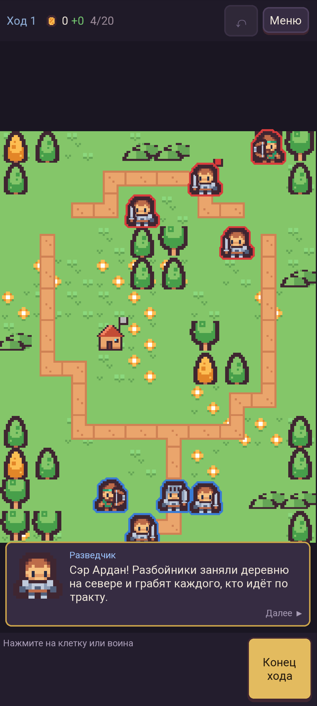
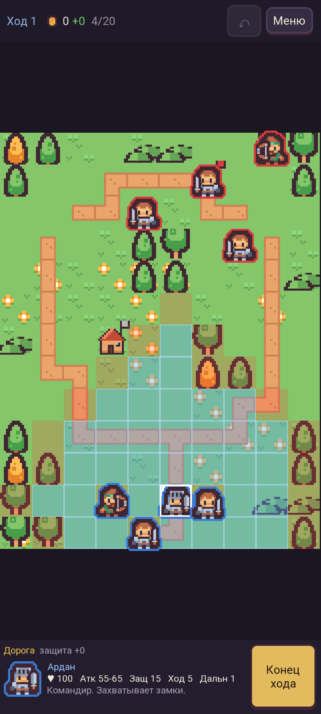
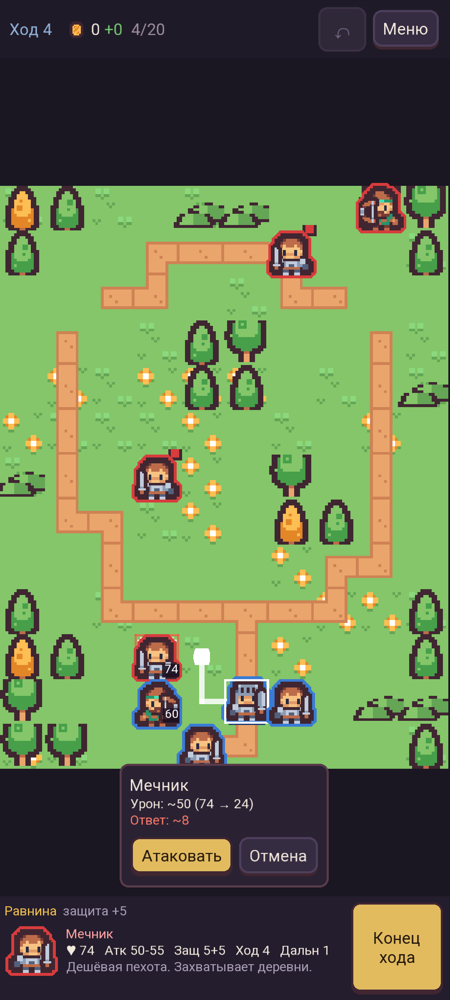
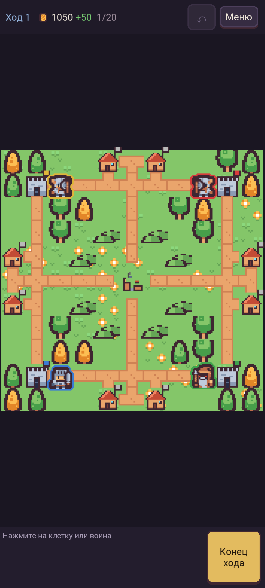
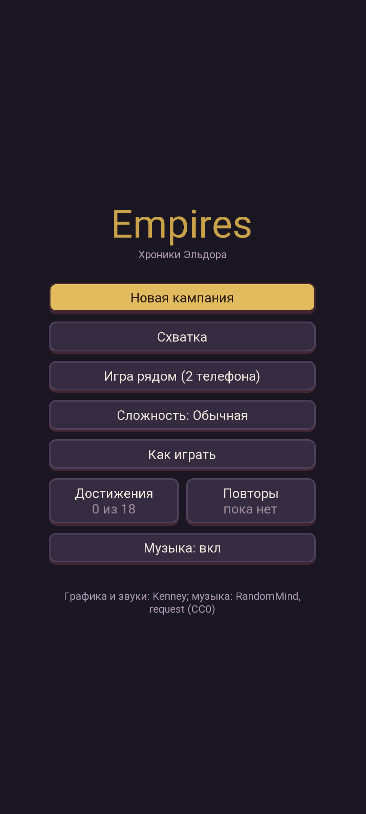
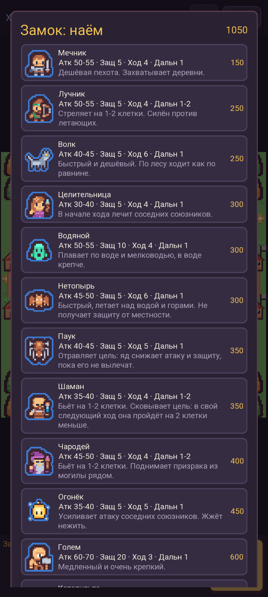
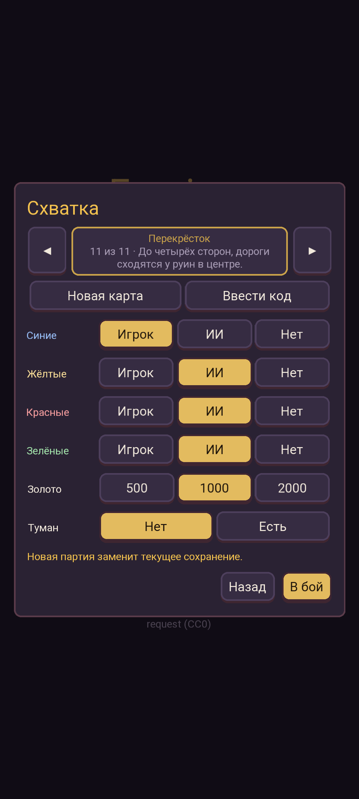
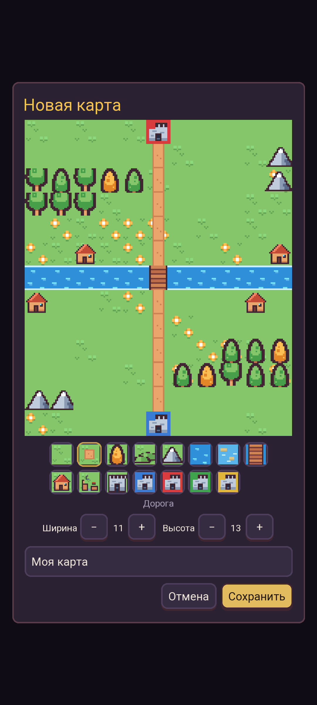

<div align="center">

# Empires: Хроники Эльдора

**Пошаговая тактическая стратегия в духе Ancient Empires 2 для телефона и браузера**

[](https://wiverhome.github.io/empires/)
[](https://github.com/WiverHome/empires/releases/latest)







</div>

Королевство Эльдор в беде: разбойники на границе, некромант в цитадели, ведьма в болотах и северная орда у мостов.
Ведите рыцаря Ардана и его отряд через три главы кампании или устройте схватку на своей карте - против компьютера,
вдвоём на одном телефоне или на двух телефонах рядом.

Игра рассчитана на вертикальный экран телефона: карта целиком помещается на экран, ничего не нужно прокручивать.
Есть две версии с одинаковыми правилами: веб (открывается в любом браузере) и нативное Android-приложение.

## Возможности

- **Кампания:** 12 миссий в трёх главах с диалогами и событиями - сопровождение кристалла, оборона мостов, бои с боссами. За победу до трёх звёзд.
- **Схватка:** 11 карт и свои карты из редактора, до четырёх сторон, любая сторона за игрока или ИИ, туман войны по желанию.
- **Редактор карт:** рисуйте пальцем, делитесь картой коротким кодом `EMP1:…`.
- **Игра вдвоём:** на одном телефоне по очереди или на двух телефонах рядом (Android: Bluetooth / Wi-Fi Direct или одна сеть Wi-Fi, интернет не нужен).
- **13 наёмных воинов** со своими особенностями: яд, сковывание, ауры, полёт, плавание, осадные катапульты. Призраки из могил, командиры с уровнями.
- **Экономика:** захват деревень и замков, доход, найм, лечение на своих зданиях, разрушение деревень и их отстройка.
- **ИИ** с тремя уровнями сложности.
- **Удобства:** автосохранение, отмена действий в пределах хода, повторы последних партий, 18 достижений, музыка и звуки.

## Воины

| | Воин | Цена | Особенность |
|---|---|---|---|
| ⚔ | Мечник | 150 | Дешёвая пехота, захватывает деревни |
| 🏹 | Лучник | 250 | Бьёт на 1-2 клетки, силён против летающих |
| 🐺 | Волк | 250 | Быстрый, по лесу ходит как по равнине |
| ✚ | Целительница | 300 | Лечит соседних союзников в начале хода |
| 🌊 | Водяной | 300 | Плавает, в воде крепче |
| 🦇 | Нетопырь | 300 | Летает над водой и горами |
| 🕷 | Паук | 350 | Отравляет: цель слабее, пока её не вылечат |
| ❄ | Шаман | 350 | Сковывает: в свой ход цель пройдёт на 2 клетки меньше |
| 🔮 | Чародей | 400 | Поднимает призраков из могил |
| ✨ | Огонёк | 450 | Усиливает соседей, жжёт нежить |
| 🗿 | Голем | 600 | Медленный и очень крепкий |
| 🎯 | Катапульта | 700 | Бьёт на 2-4 клетки, разрушает деревни |
| 😈 | Демон | 1000 | Летающий и смертоносный |

## Скриншоты

<p align="center">




</p>

## Как играть

1. Нажмите на своего воина: синим подсвечено, куда он дойдёт, красным - где опасно.
2. Нажмите на клетку, чтобы сходить, и выберите действие: атаковать, захватить, ждать.
3. Быстрая атака: выбрав воина, нажмите на врага в рамке - воин сам подойдёт на лучшую клетку и покажет прогноз удара.
4. В своём замке нанимайте новых воинов, деревни приносят золото.
5. Кнопка ↶ отменяет действия текущего хода, «Конец хода» передаёт ход противнику.

Полные правила - в игре, раздел «Как играть».

## Установка

**Браузер:** просто откройте https://wiverhome.github.io/empires/ - на телефоне или компьютере.

**Android 8.0+:** скачайте `empires-*.apk` со страницы [релизов](https://github.com/WiverHome/empires/releases/latest)
и откройте файл на телефоне. Android попросит разрешить установку из этого источника - это нормально для приложений не из Google Play.

## Сборка из исходников

### Веб

Сборки нет - обычные файлы `index.html`, `style.css` и `js/*.js`. Нужен только локальный сервер
(с `file://` браузер не даёт читать пиксели картинок):

```bash
node tools/serve.js
```

и открыть http://localhost:5173.

### Android

Нативное приложение на Kotlin + libGDX (без WebView). Нужны JDK 17 и Android SDK (путь к SDK - в `android/local.properties`):

```bash
cd android && ./gradlew :app:assembleDebug
```

APK появится в `android/app/build/outputs/apk/debug/`.

Релиз: `./gradlew :app:assembleRelease`. Ключ подписи и пароли берутся из `android/local.properties`
(`release.storeFile`, `release.storePassword`, `release.keyAlias`, `release.keyPassword`); ни ключ, ни этот файл в git не попадают.
Без ключа релиз подписывается отладочным ключом.

## Устройство проекта

```
index.html, style.css, js/   веб-версия (эталон правил)
  js/rules.js, ai.js, ...     правила и ИИ без DOM
  js/campaign.js, skirmish.js миссии, карты, диалоги
android/logic/               те же правила на Kotlin, один к одному
android/app/                 Android-приложение: графика, интерфейс, звук, сеть
assets/                      картинки и звуки (общие для обеих версий)
tools/                       проверки: карты, симуляция ИИ против ИИ
```

Правила в двух версиях совпадают до бита: случайность хранится в состоянии партии, а симуляция на Kotlin
выдаёт тот же текст, что и на JavaScript. Это проверяется так:

```bash
node tools/check-maps.js              # карты миссий
node tools/sim.js --runs 3 --replay   # ИИ против ИИ + проверка повторов
cd android && ./gradlew :logic:test :logic:run --args="--runs 3 --replay"   # то же на Kotlin, вывод должен совпасть
```

## Лицензия

- Код - [MIT](LICENSE).
- Графика, звуки и музыка - CC0 1.0 (общественное достояние): Kenney, request, RandomMind. Подробности - в [`assets/CREDITS.md`](assets/CREDITS.md).
- Сторонние библиотеки Android-версии (libGDX, Kotlin, kotlinx.coroutines, FreeType, Google Play services) - в [`THIRD_PARTY_NOTICES.md`](THIRD_PARTY_NOTICES.md).

## Благодарности

- [Kenney](https://kenney.nl) - тайлы, фигурки и звуки.
- [request](https://opengameart.org/users/request) и [RandomMind](https://opengameart.org/users/randommind) - музыка.
- Ancient Empires 2 - за вдохновение.
